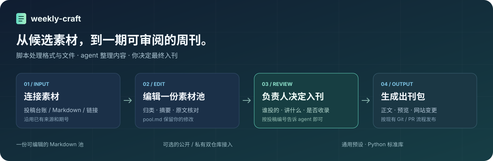
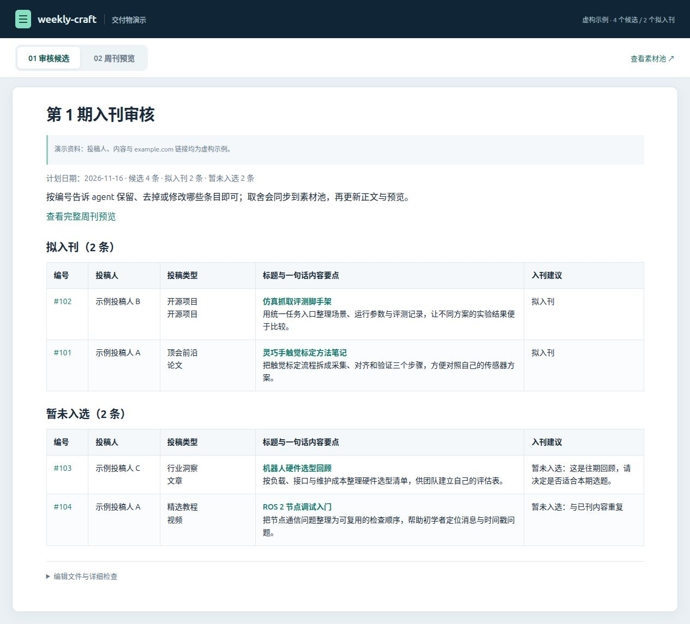
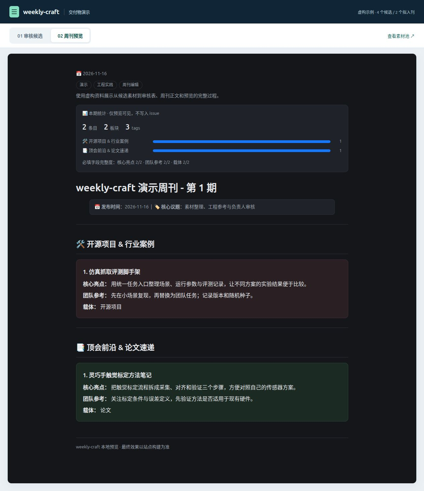
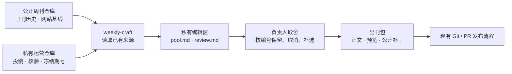

<div align="center">

# weekly-craft

**从候选素材，到一期可审阅的周刊。**

脚本处理格式与文件，agent 整理内容，你决定最终入刊。

[](https://github.com/kingdream-cn/weekly-craft/actions/workflows/test.yml)


[](LICENSE)

[效果预览](#效果预览) · [快速开始](#快速开始) · [双仓库接入](#连接你的两个周刊仓库) · [文档与维护](#文档与维护)

</div>



weekly-craft 是一个可复用的 Agent Skill，也是一套可独立使用的 Python CLI。把链接、投稿或自由草稿变成结构统一的 Markdown 周刊，并准备审核表、正文预览和网站更新。

- **每期只维护一份素材池**：勾选、改摘要、调板块；重复准备保留已有编辑。
- **审核围绕内容取舍**：看投稿人、类型和一句话要点，按编号告诉 agent 保留或取消。
- **适配已有周刊**：普通草稿直接用；已有投稿运营台账时，再连接公开与私有仓库。

## 效果预览

下面使用 **4 个虚构候选、2 个拟入刊条目** 展示实际脚本产物。姓名、内容和 example.com 链接都是演示资料。

**负责人审核表**：拟入刊与暂未入选分组，具体问题直接呈现。完整核验过程收在详细检查中。

[](assets/readme/review.png)

<details>
<summary><strong>展开查看周刊正文预览</strong></summary>

卡片、板块统计和阅读排版来自现有 `preview.py`，支持跟随系统的明暗主题。最终站点以目标项目构建结果为准。

[](assets/readme/preview.png)

</details>

[本地交互演示](docs/demo.html)提供“审核候选／周刊预览”双视图切换。clone 后用浏览器打开 `docs/demo.html` 即可体验；GitHub 文件页可查看或下载 HTML。[示例源文件](examples/demo/)也可直接阅读。

## 快速开始

运行脚本需要 **Python 3.9+**，只使用标准库。先试一份完整示例：

```bash
git clone https://github.com/kingdream-cn/weekly-craft.git
cd weekly-craft

python3 scripts/validate_issue.py examples/demo/issue-1.md \
  --config examples/demo/config.json
python3 scripts/preview.py examples/demo/issue-1.md \
  --config examples/demo/config.json --out preview.html --open
```

看到校验 `PASS` 后，浏览器会打开生成的周刊预览。试改 [examples/demo/pool.md](examples/demo/pool.md)，再转换、校验和预览，就能体验一次编刊。

<details>
<summary><strong>从素材池生成正文</strong></summary>

```bash
python3 scripts/pool_to_issue.py examples/demo/pool.md \
  --config examples/demo/config.json --out issue-1.md
python3 scripts/validate_issue.py issue-1.md --config examples/demo/config.json
python3 scripts/preview.py issue-1.md --config examples/demo/config.json --open
```

命令保留原示例；输出到当前目录。已有同名正文时，先核对文件，明确需要覆盖再使用 `--force`。

</details>

<details>
<summary><strong>从空白草稿开始</strong></summary>

```bash
python3 scripts/new_issue.py --number 1 --out my-weekly/issues
# agent 或编辑补充生成的草稿
python3 scripts/validate_issue.py my-weekly/issues/issue-1.md
python3 scripts/preview.py my-weekly/issues/issue-1.md --open
```

普通模式采用中性默认。设置 `--config` 可换成自己的预设。素材元信息抓取脚本可按需使用，不要求每期重新搜集。

</details>

## 作为 skill 使用

clone 后，在仓库根目录把完整目录链接到 Codex 的用户 skill 目录：

```bash
mkdir -p ~/.agents/skills
ln -s "$(pwd)" ~/.agents/skills/weekly-craft
```

已有同名路径时，先核对原安装。Codex 支持该目录的自动发现和软链接；未出现时重启。其他 Agent Skills 宿主使用各自的技能目录。安装机制见 [OpenAI 官方文档](https://learn.chatgpt.com/docs/build-skills)。

接下来直接说：

```text
使用 $weekly-craft，按已有配置准备本期周刊。
整理摘要、生成审核表和预览，把需要我决定的事项列出来。
```

审核后，可以继续说：

```text
保留 #101 和 #102；#103 留到回顾选题。
把 #101 的团队参考改得更具体，再给我更新后的预览。
```

内容理解使用当前 agent 的模型能力。CLI 本身不需要额外模型 API 密钥，摘要也可以由编辑手工填写。

## 连接你的两个周刊仓库

公开仓库保存投稿 Issue、已刊 Markdown 和网站；私有运营仓库已有 `private-ledger-v1` 台账。weekly-craft 读取这些结果，复用期号、有效性和去重信息。



**连接一次：**

```bash
python3 scripts/editorial.py connect \
  --public-repo /path/to/public-weekly \
  --private-repo /path/to/private-operations
```

**每期准备与生成：**

```bash
python3 scripts/editorial.py prepare \
  --config /path/to/private-operations/.weekly-private/weekly-craft.json --refresh
# agent 更新返回目录中的 pool.md；负责人按 review.md 的编号决定取舍
python3 scripts/editorial.py build \
  --config /path/to/private-operations/.weekly-private/weekly-craft.json --number 47
```

`47` 替换成 prepare 返回的期号。已有 `WEEKLY_CONFIG` 或工作目录 `weekly.config.json` 时可省略 `--config`。没有这类台账时，先用上面的普通草稿与素材池工具；当前接入器不是任意私有仓库的通用同步器。

| 留在私有编辑区 | 供公开审阅的变更 |
| --- | --- |
| 素材池、审核表、姓名展示、来源与检查记录 | 本期正文、VitePress 侧边栏、README 近期入口 |

有效投稿默认拟入刊，最终取舍由负责人决定。身份核验、完成统计和通知继续使用原运营系统；发布按当前用户指令执行。周期选择、姓名来源与应用补丁详见 [双仓库编刊](references/dual-repo.md)。

## 换成你的排版

只覆盖需要修改的字段，例如：

```json
{"extends": "embodied-ai-weekly-live", "site_name": "我的周刊"}
```

| 预设 | 适合什么场景 |
| --- | --- |
| `minimal` | 中性三板块，单字段摘要，普通技术或阅读周刊 |
| `embodied-ai-weekly-live` | 现役具身周刊七类，空栏目可省略 |
| `embodied-ai-weekly` | 原五板块，兼容已有格式 |
| `embodied-ai-weekly-legacy` | 历史板块变体，兼容旧期刊 |

配置优先级：`--config` → `WEEKLY_CONFIG` → 当前目录 `weekly.config.json` → `extends` → 内置默认。板块、字段和配色可配置；现役预设不强制阅读时长或固定摘要长度。见 [预设指南](references/presets-guide.md)与[配置示例](config.example.json)。

## 文档与维护

| 你要做什么 | 读这里 |
| --- | --- |
| 让 agent 编刊 | [SKILL.md](SKILL.md) |
| 接入公开与私有仓库、准备出刊包 | [双仓库编刊](references/dual-repo.md) |
| 调整风格或添加预设 | [预设指南](references/presets-guide.md) |
| 提交或推送正文 | [发布说明](references/publishing.md) |
| 修改这个 skill 的源码与文档 | [AGENTS.md](AGENTS.md) · [AGENT.md 入口](AGENT.md) |
| 贡献改动或查看版本变化 | [贡献说明](CONTRIBUTING.md) · [更新记录](CHANGELOG.md) |

修改脚本、配置或预设后运行 `bash tests/run_tests.sh`。测试覆盖配置、素材池、真实本地 Git 接入与发布、公开导出、历史格式和错误样本；CI 使用 Python 3.9–3.12 矩阵。示例演示可离线打开，目标 VitePress 网站构建沿用其 Node/npm 环境。

[MIT License](LICENSE)
